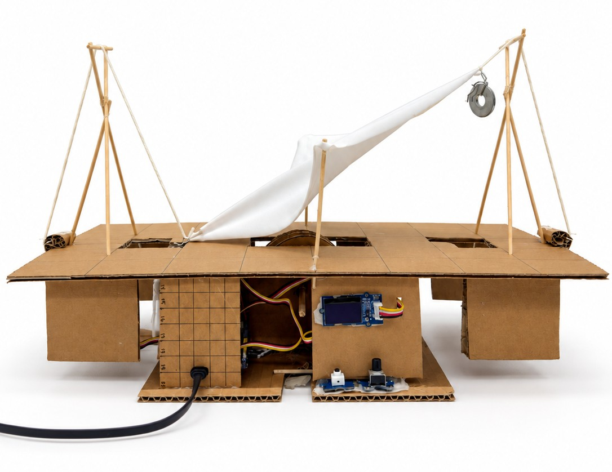
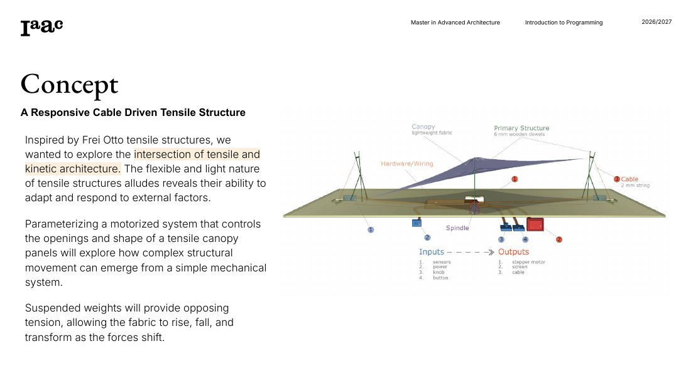
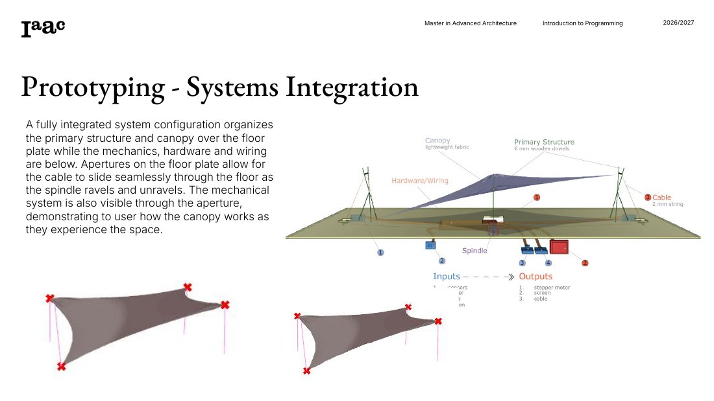
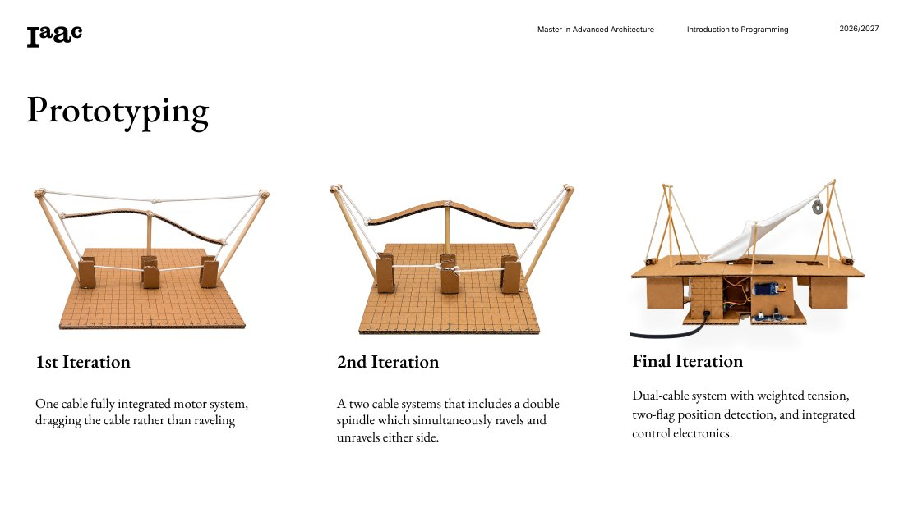
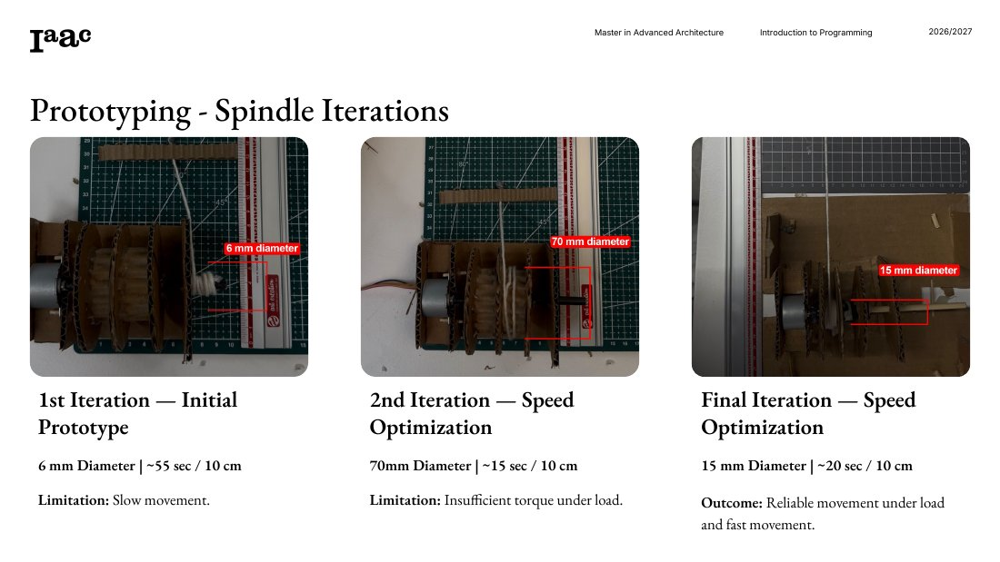
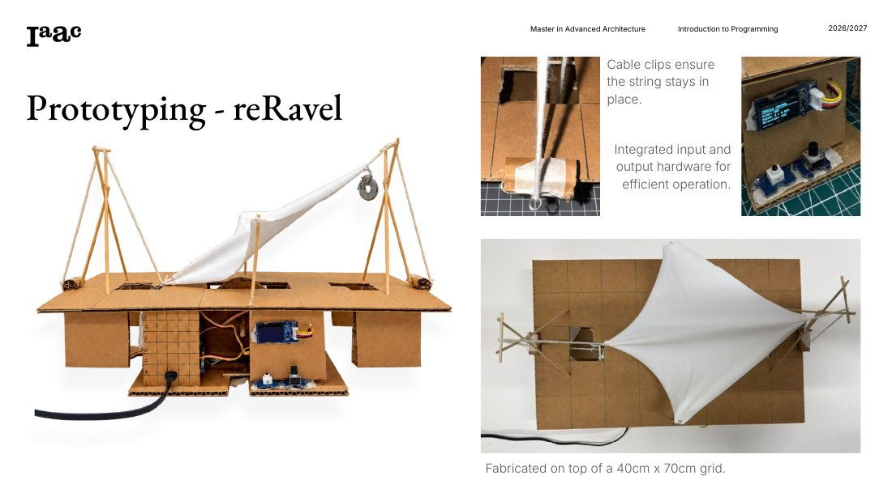
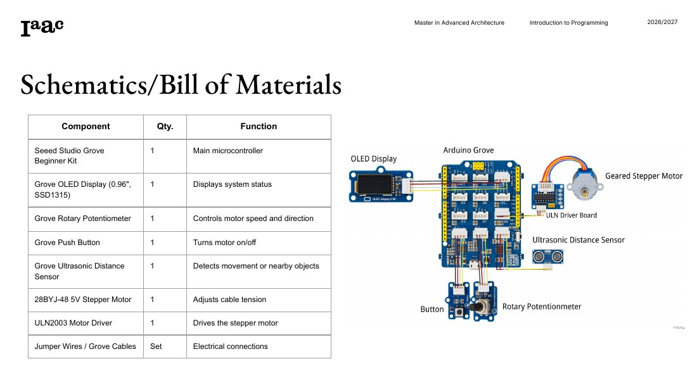

# reRavel: Adaptive Tensile Structure

A responsive, cable-driven tensile canopy. A single stepper motor winds and unwinds cables on a spindle, and suspended weights pull back against it. Together they raise, lower and reshape a fabric canopy.

Built for the **Introduction to Programming & Physical Computing Seminar** in IAAC's Master in Advanced Architecture, 2026/2027.

- **Students:** Daniel Feldman, Talbert DeAndre Herndon
- **Instructor:** Daniel Mateos San Martin

## Concept

Inspired by Frei Otto's tensile structures, reRavel explores where **tensile and kinetic architecture** meet. Tensile structures are flexible and light, so they can adapt and respond to outside forces.

A motorized system controls the canopy's openings and shape. The project explores how complex structural movement can come from a simple mechanical system. Suspended weights provide opposing tension, so the fabric rises, falls and transforms as the forces shift.

**System layout:**
- **Above the floor plate:** the primary structure (6 mm wooden dowels) and a lightweight fabric canopy.
- **Below the floor plate:** the mechanics, hardware and wiring.
- **Openings in the floor plate:** they let the 2 mm cable slide through as the spindle winds and unwinds. Visitors can also see the mechanism through them, which shows how the canopy works while they experience the space.

## Prototyping

| Iteration | Description |
|---|---|
| 1st | One-cable, fully integrated motor system, dragging the cable rather than winding it |
| 2nd | A two-cable system with a double spindle that winds and unwinds either side at the same time |
| Final | Dual-cable system with weighted tension, two-flag position detection and integrated control electronics |

### Spindle iterations

The spindle diameter trades speed against torque:

| Spindle diameter | Speed | Result |
|---|---|---|
| 6 mm | ~55 s per 10 cm | Too slow |
| 70 mm | ~15 s per 10 cm | Fast, but not enough torque under load |
| **15 mm** (final) | **~20 s per 10 cm** | **Reliable under load, with good speed** |

### Final prototype

Built on top of a 40 cm × 70 cm grid. Cable clips keep the string in place, and the input and output hardware are mounted on the front for easy use.

## Hardware

| Component | Qty | Function |
|---|---|---|
| Seeed Studio Grove Beginner Kit | 1 | Main microcontroller |
| Grove OLED Display (0.96", SSD1315) | 1 | Displays system status |
| Grove Rotary Potentiometer | 1 | Controls motor speed and direction |
| Grove Push Button | 1 | Turns the motor on and off |
| Grove Ultrasonic Distance Sensor | 1 | Detects movement or nearby objects |
| 28BYJ-48 5V Stepper Motor | 1 | Adjusts cable tension |
| ULN2003 Motor Driver | 1 | Drives the stepper motor |
| Jumper wires / Grove cables | Set | Electrical connections |

### Pin connections used by this sketch

| Part | Pin |
|---|---|
| ULN2003 IN1–IN4 | 8, 9, 10, 11 |
| Rotary potentiometer | A6 |
| Push button | D3 (HIGH when pressed) |
| Grove ultrasonic sensor (single signal pin) | A2 |

The OLED display is part of the hardware setup but is not used in this code yet.

## How the code works

[`adaptive_tensile.ino`](adaptive_tensile.ino)

- **Button:** toggles the motor on and off, debounced so one press counts once. When the motor turns on, the dial's position sets the starting direction.
- **Potentiometer:** sets the speed. The center position (with a ±50 dead zone) stops the motor, and the further the knob is from center, the faster it moves (1–7 RPM).
- **Two-flag detection:** the ultrasonic sensor watches for flags on the cable. When a flag comes within 8 cm, the motor reverses direction, so the canopy moves back and forth between the two flags. The flag must move beyond 11 cm before it can trigger again, and the sensor ignores further triggers for 20 seconds after each reversal.
- **Serial Monitor (9600 baud):** shows the motor's on/off state, each flag detection with a running count, the new direction and when the sensor is ready again.

### Uploading

1. Open `adaptive_tensile.ino` in the Arduino IDE. It uses the built-in `Stepper` library, so nothing else needs installing.
2. Select your board and port.
3. Click **Upload**, then open the Serial Monitor at 9600 baud.
